# `Ansible part 2`" - "`Bomba`"
   

### Задание 1

Выполните действия, приложите файлы с плейбуками и вывод выполнения.
Напишите три плейбука. При написании рекомендуем использовать текстовый редактор с подсветкой синтаксиса YAML.
Плейбуки должны:

    Скачать какой-либо архив, создать папку для распаковки и распаковать скаченный архив. Например, можете использовать [официальный сайт](https://kafka.apache.org/downloads) и зеркало Apache Kafka. При этом можно скачать как исходный код, так и бинарные файлы, запакованные в архив — в нашем задании не принципиально.
    Установить пакет tuned из стандартного репозитория вашей ОС. Запустить его, как демон — конфигурационный файл systemd появится автоматически при установке. Добавить tuned в автозагрузку.
    Изменить приветствие системы (motd) при входе на любое другое. Пожалуйста, в этом задании используйте переменную для задания приветствия. Переменную можно задавать любым удобным способом.


---

#### плей kafka

```yaml

- name: Download and unpack Kafka
  hosts: droplet
  become: true

  vars:
    kafka_version: "3.9.0"
    kafka_scala: "2.13"
    kafka_url: "https://archive.apache.org/dist/kafka/{{ kafka_version }}/kafka_{{ kafka_scala }}-{{ kafka_version }}.tgz"
    kafka_archive: "/tmp/kafka_{{ kafka_scala }}-{{ kafka_version }}.tgz"
    kafka_dir: "/opt/kafka"

  tasks:
    - name: Download Kafka archive
      ansible.builtin.get_url:
        url: "{{ kafka_url }}"
        dest: "{{ kafka_archive }}"
        mode: '0644'

    - name: Create directory for Kafka
      ansible.builtin.file:
        path: "{{ kafka_dir }}"
        state: directory
        mode: '0755'


    - name: Unpack archive
      ansible.builtin.unarchive:
        src: "{{ kafka_archive }}"
        dest: "{{ kafka_dir }}"
        remote_src: true
        creates: "{{ kafka_dir }}/kafka_{{ kafka_scala }}-{{ kafka_version }}/bin/kafka-server-start.sh"


```


Плейбук скачивает архив и распаковывает его.


**Kafka** — платформа передачи событий логи, метрики, 
обмен сообщениями между сервисами в реальном времени

#### пушу плейбук

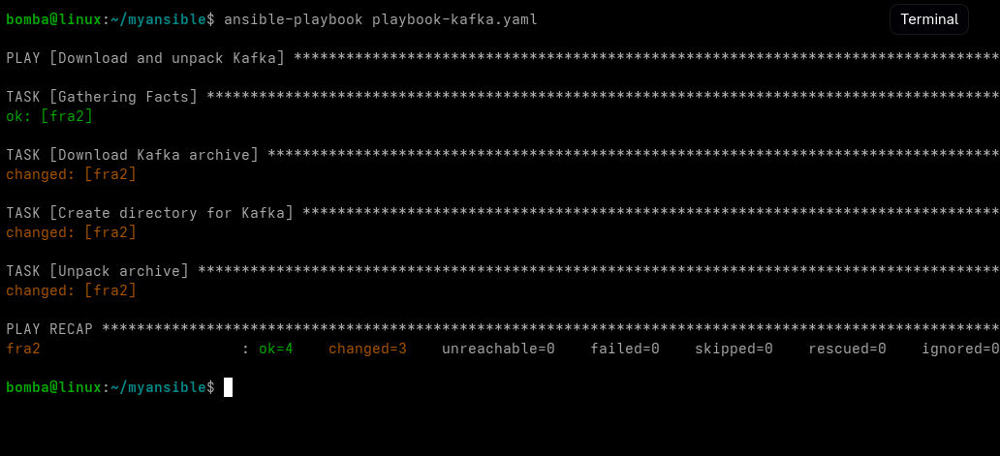


Плейбук успешно сработал, Kafka скачалась в tmp а от туда уже распаковалась в opt

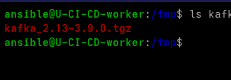

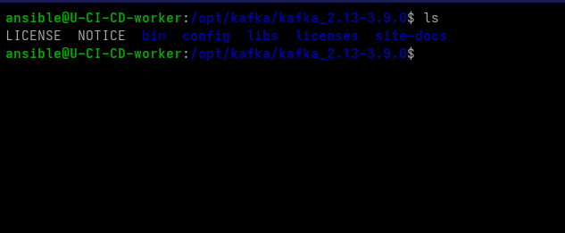

Во всех плейбуках использую полные имена модулей с одноимёнными модулями сторонних коллекций. 
ansible-lint рекомендует как best practice.


#### плей tuned

```yaml

- name: Install and enable tuned
  hosts: droplet
  become: true

  tasks:
    - name: Install tuned package
      ansible.builtin.apt:
        name: tuned
        state: present
        update_cache: true

    - name: Start tuned and enable on boot
      ansible.builtin.service:
        name: tuned
        state: started
        enabled: true

```

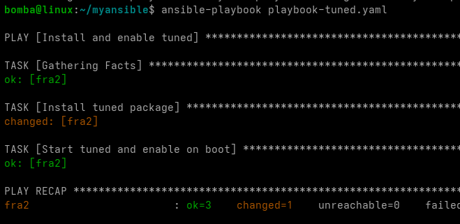

Все прошло успешно сервис tuned скачался и запустился НО tuned запустился сам,
потому что apt запускает сервис автоматом.

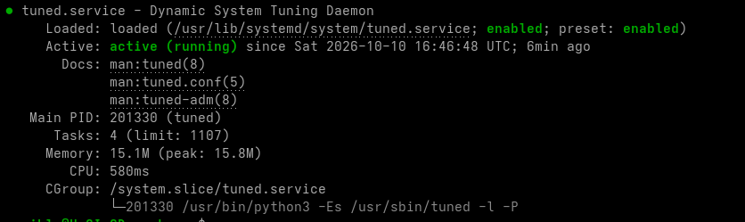

#### плей motd

```yaml

- name: Configure MOTD
  hosts: droplet
  become: true

  vars:
    motd_text: |
      ---------------------------------------------------
      Хост принимающий плейбуки (хорошего дня безопасник)
      ----------------------------------------------------
  tasks:
    - name: Set custom motd
      ansible.builtin.copy:
        content: "{{ motd_text }}"
        dest: /etc/motd
        owner: root
        group: root
        mode: '0644'

```
#### пушу плейбук 

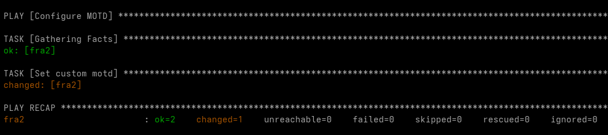

Плей успешно отработал и перезаписал конфиг файл в /etc/motd


---

### Задание 2

Выполните действия, приложите файлы с модифицированным плейбуком и вывод выполнения.
Модифицируйте плейбук из пункта 3, задания 1. В качестве приветствия он должен установить IP-адрес и hostname управляемого хоста, пожелание хорошего дня системному администратору.

---

#### модифицированный плей motd

```yaml
- name: Configure MOTD
  hosts: droplet
  become: true

  vars:
    motd_text: |
      ---------------------------------------------------
      (Модификация старого play) Хорошего дня админ!
      ----------------------------------------------------
      Хост: {{ ansible_facts.hostname }}
      IP: {{ ansible_facts.default_ipv4.address }}
      ОС: {{ ansible_facts.distribution }}


  tasks:
    - name: Set custom motd
      ansible.builtin.copy:
        content: "{{ motd_text }}"
        dest: /etc/motd
        owner: root
        group: root
        mode: '0644'
```
#### пушу плей

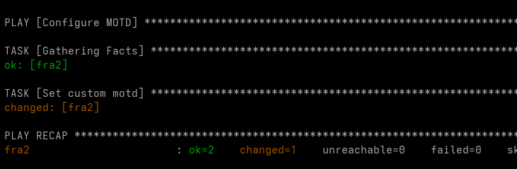

плейбук успешно сработал

видно что при входе на сервер данные об IP HOST и OS собраются отлично

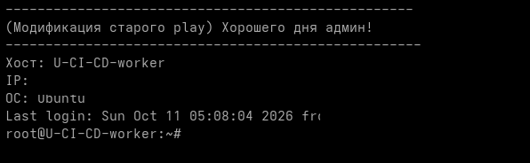


---

### Задание 3

Задание 3
Выполните действия, приложите архив с ролью и вывод выполнения.
Ознакомьтесь со статьёй [«Ansible - это вам не bash»](https://habr.com/ru/post/494738/), сделайте соответствующие выводы и не используйте модули shell или command при выполнении задания.
Создайте плейбук, который будет включать в себя одну, созданную вами роль. Роль должна:

    Установить веб-сервер Apache на управляемые хосты.
    Сконфигурировать файл index.html c выводом характеристик каждого компьютера как веб-страницу по умолчанию для Apache. Необходимо включить CPU, RAM, величину первого HDD, IP-адрес. Используйте [Ansible facts](https://docs.ansible.com/ansible/latest/playbook_guide/playbooks_vars_facts.html) и [jinja2-template](https://linuxways.net/centos/how-to-use-the-jinja2-template-in-ansible/). Необходимо реализовать handler: перезапуск Apache только в случае изменения файла конфигурации Apache.
    Открыть порт 80, если необходимо, запустить сервер и добавить его в автозагрузку.
    Сделать проверку доступности веб-сайта (ответ 200, модуль uri).


---

#### плейбук роли 

```yaml
---
- name: Deploy Apache with custom index
  hosts: droplet
  become: true

  roles:
    - roleNETOapache

```


Мейн ямл /tasks/main.yaml


```yaml

#SPDX-License-Identifier: MIT-0
---
# tasks file for roleNETOapache

- name: Install Apache
  ansible.builtin.apt:
    name: apache2
    state: present
    update_cache: true

- name: Deploy index.html from template
  ansible.builtin.template:
    src: index.html.j2
    dest: /var/www/html/index.html
    owner: root
    group: root
    mode: '0644'
  notify: Restart apache

- name: Open port 80
  community.general.ufw:
    rule: allow
    port: '80'
    proto: tcp

- name: Start apache and enable on boot
  ansible.builtin.service:
    name: apache2
    state: started
    enabled: true

- name: Check website availability
  ansible.builtin.uri:
    url: "http://{{ ansible_facts.default_ipv4.address }}"
    status_code: 200
    
~                          
```

/handlers/main.yml хендлер срабатывает только когда задача сообщила об изменении

```yaml
---
- name: Restart apache
  ansible.builtin.service:
    name: apache2
    state: restarted
```


/templates/index.html.j2

```html

<!DOCTYPE html>
<html lang="ru">
<head>
    <meta charset="utf-8">
    <title>{{ ansible_facts.hostname }}</title>
    <style>
        body { font-family: monospace; background: #1e1e1e; color: #d4d4d4; padding: 40px; }
        h1 { color: #4ec9b0; }
        table { border-collapse: collapse; margin-top: 20px; }
        td { padding: 8px 20px 8px 0; border-bottom: 1px solid #333; }
        td:first-child { color: #9cdcfe; }
    </style>
</head>
<body>
    <h1>{{ ansible_facts.hostname }}</h1>

    

    <table>
        <tr><td>IP-адрес</td><td>{{ ansible_facts.default_ipv4.address }}</td></tr>
        <tr><td>CPU</td><td>{{ ansible_facts.processor[2] | default(ansible_facts.processor[0]) }}</td></tr>
        <tr><td>Ядер</td><td>{{ ansible_facts.processor_vcpus }}</td></tr>
        <tr><td>RAM</td><td>{{ ansible_facts.memtotal_mb }} MB</td></tr>
        <tr><td>Диск {{ disk }}</td><td>{{ ansible_facts.devices[disk].size }}</td></tr>
        <tr><td>ОС</td><td>{{ ansible_facts.distribution }} {{ ansible_facts.distribution_version }}</td></tr>
    </table>

    <p>Ansible {{ ansible_date_time.date }}</p>
</body>
</html>

```

#### пушу роль

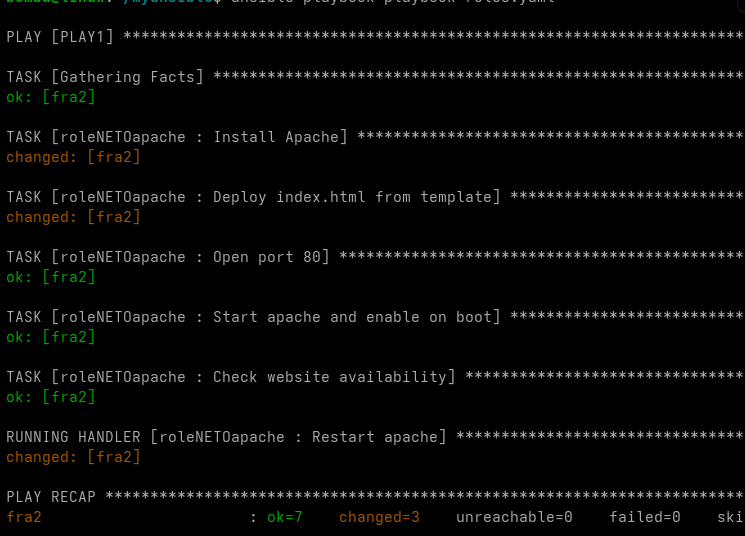

первый прогон был боевой порт 80 уже был открыт
apache скачался и запустился 

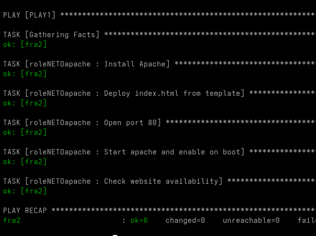


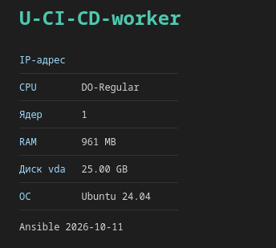

видим как все работает, данные о хосте собраны

Роль установила Apache и развернула index.html из шаблона.

Второй раз ничего не менялось, все задачи ok, changed=0, handler не вызывался.

Пототму что ансибл идемпотентный

